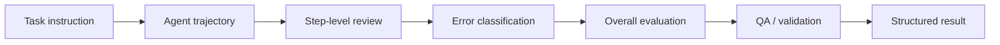
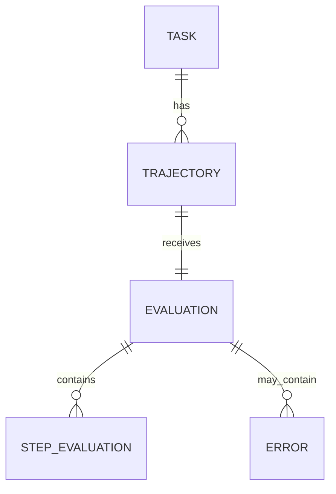

# Computer-Use Evaluation Lab

A public demonstration of **computer-use trajectory evaluation, step-level review, error analysis, and QA** using original synthetic desktop and browser tasks.

The project is intentionally platform-neutral. It shows the evaluation method and supporting tooling without exposing proprietary tasks, client data, internal platforms, or NDA-restricted rubrics.

## What this project demonstrates

- structured review of multi-step desktop and browser trajectories
- step-level assessment of action quality and observed effects
- task-completion and instruction-following checks
- tool-use and efficiency analysis
- reusable error classification
- JSON-based task, trajectory, and evaluation records
- Python validation, summaries, and a small HTML report
- examples of successful, inefficient, and incomplete trajectories

## Evaluation flow



## Step-level rubric

| Dimension | Review question |
| --- | --- |
| Consistency | Is the step consistent with the visible state and prior context? |
| Action match | Does the action match what the task requires at this point? |
| Reasonableness | Is the action a reasonable choice for making progress? |
| Intended effect | Did the step produce the intended state change? |

The overall review separately considers **instruction following, tool use, task completion, and efficiency**.

## Included cases

### Successful task
A direct trajectory that completes a note-creation task without unnecessary actions.

### Tool-use issue
A trajectory that reaches the requested outcome but opens and uses an unrelated application. This separates **completion** from **execution quality**.

### Incomplete task
A file-organization task where one required file is selected but never moved. The action is plausible, but the required end state is not reached.

## Repository structure

```text
computer-use-evaluation-lab/
├── data/
│   ├── tasks.json
│   ├── trajectories.json
│   └── evaluations.json
├── rubrics/
│   ├── step_evaluation.json
│   └── error_taxonomy.json
├── examples/
│   ├── successful-task/
│   ├── tool-use-error/
│   └── incomplete-task/
├── scripts/
│   ├── validate_evaluation.py
│   ├── summarize_results.py
│   └── generate_report.py
├── tests/
│   └── test_validation.py
├── docs/
│   └── evaluation-methodology.md
├── screenshots/
├── pyproject.toml
├── LICENSE
└── README.md
```

## Data model



## Run the validator

No third-party Python packages are required.

```bash
python scripts/validate_evaluation.py
```

Expected output:

```text
Validation passed.
```

## Summarize results

```bash
python scripts/summarize_results.py
```

## Generate a local report

```bash
python scripts/generate_report.py
```

Open `report.html` in a browser to view a compact visual summary generated directly from the JSON data.

## Run tests

```bash
python -m unittest discover -s tests -v
```

## Why the project uses synthetic data

Professional AI evaluation work often involves confidential tasks, customer data, internal tooling, or NDA-restricted instructions. This repository therefore uses **original synthetic tasks and trajectories**. It demonstrates the workflow without reproducing or implying access to client material.

## Extending the project

The project is data-driven. To add another evaluation case:

1. Add the task to `data/tasks.json`.
2. Add its trajectory to `data/trajectories.json`.
3. Add the corresponding evaluation to `data/evaluations.json`.
4. Run the validator and tests.

The scripts do not need to be rewritten for each new case.

## License

MIT
